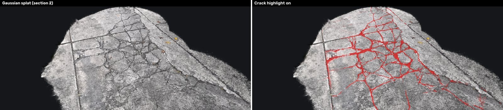
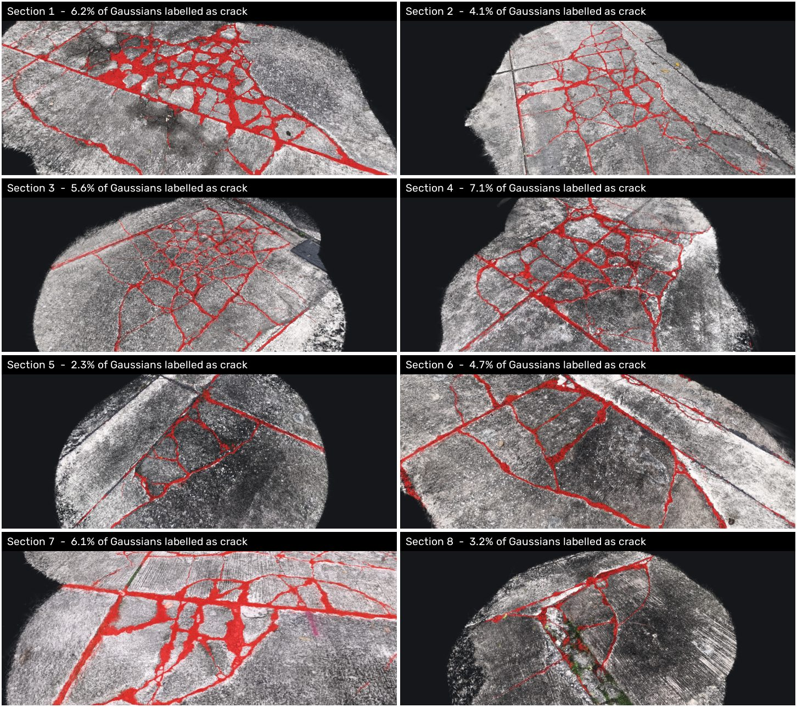
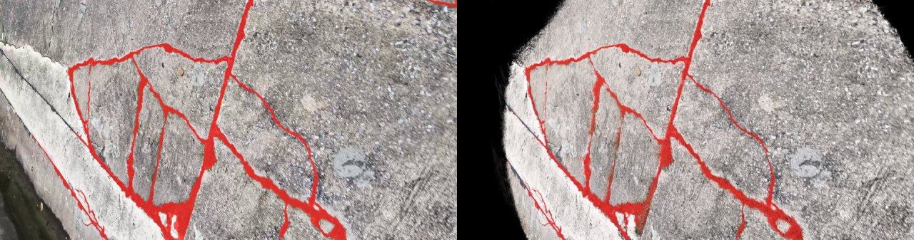
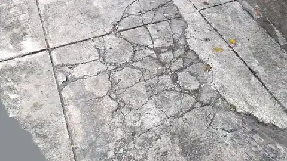
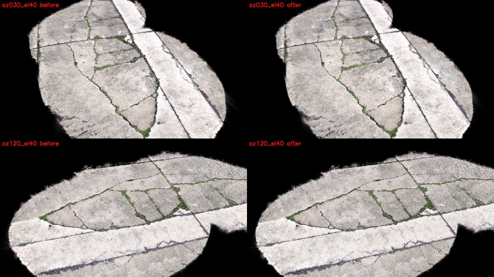
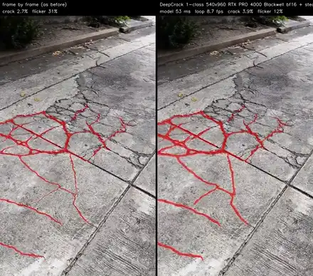
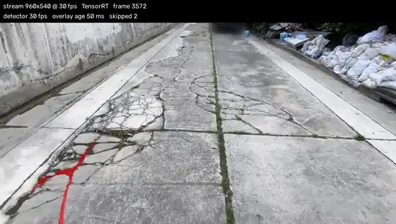
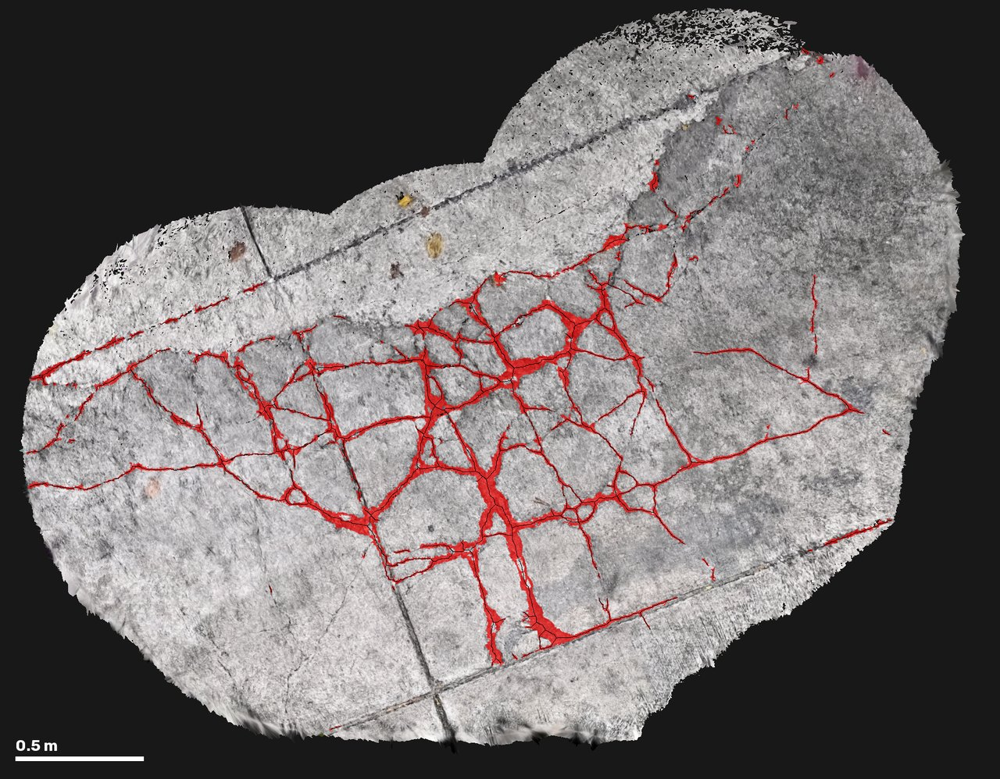

# Road Crack 3D Segmentation

Turning phone video of cracked concrete roads into 3D Gaussian Splatting reconstructions, with cracks
segmented on every Gaussian. A browser viewer can highlight the cracks, and a TensorRT pipeline detects
cracks in video in real time.

<p align="center">
  
</p>

## Contents

1. [Overview](#overview)
2. [Gallery](#gallery)
3. [Repository structure](#repository-structure)
4. [Method](#method)
5. [Crack segmentation model](#crack-segmentation-model)
6. [Results](#results)
7. [Getting started](#getting-started)
8. [Limitations](#limitations)
9. [Privacy](#privacy)
10. [Licence and third-party components](#licence-and-third-party-components)
11. [References](#references)

## Overview

The system documents surface cracking on concrete roads in 3D from ordinary handheld smartphone video, and
reuses the same crack model for on-device inspection.

- **3D reconstruction.** Each video clip goes through:
  - Structure-from-Motion (COLMAP [[4]](#ref-4));
  - 3D Gaussian Splatting [[2]](#ref-2) (gsplat [[3]](#ref-3)), regularised with a monocular depth prior (Depth Anything 3 [[6]](#ref-6));
  - floater removal;
  - diffusion-based refinement of views away from the camera path (Difix3D+ [[5]](#ref-5)).
- **Crack segmentation in 3D.** An in-house DeepCrack [[1]](#ref-1) model with a ConvNeXt-Small [[7]](#ref-7) encoder segments every photo
  of the clip. Its per-pixel crack probability is carried onto the Gaussians through the renderer's gradients,
  which gives each Gaussian a crack share; Gaussians above a threshold are labelled as crack.
- **Visualisation.** The eight reconstructed road sections are published for the browser
  (GaussianSplats3D). The crack highlight can be switched on and off.
- **Edge inference.** The crack model runs on video frame by frame, with temporal stabilisation. It was
  deployed as a TensorRT engine and evaluated in a simulated 30 fps camera stream.

| Key figure | Value |
|---|---|
| Road sections reconstructed and segmented | 8 of 8 (3.6–6.3 million Gaussians each) |
| Gaussians labelled as crack | 2.3–7.1% per section |
| Cracks measured on the road plane | about 7–138 m of crack per section, 3.8–11.5% of the surveyed surface |
| Crack model, TensorRT BF16, 960×544 | 7.8 ms per frame (128 fps), mask IoU 0.995 against PyTorch |
| Streaming simulation (30 fps camera) | detector at 30 fps, overlay latency 42–47 ms (median) |

## Gallery

**All eight road sections with the crack highlight on**, as shown in the browser viewer.

<p align="center"></p>

**Crack labels carried into 3D.** Left: the detector on a source photograph. Right: the reconstruction from
the same pose, with Gaussians labelled as crack drawn in red.

<p align="center"></p>

**Orbit around a reconstruction** (section 2; full video:
[`samples/videos/orbit/hole_2_151720_orbit.mp4`](samples/videos/orbit/hole_2_151720_orbit.mp4)).

<p align="center"></p>

**Difix3D+ refinement**, before (left) and after (right), seen from novel viewpoints.

<p align="center"></p>

**Temporal stabilisation of the video detector.** Left: frame-by-frame output. Right: stabilised output
(full video:
[`samples/videos/edge_ai/hole_2_151720_edge_compare.mp4`](samples/videos/edge_ai/hole_2_151720_edge_compare.mp4)).

<p align="center"></p>

**Real-time streaming simulation** with the TensorRT engine, on a road walk (full video:
[`samples/videos/stream_sim/walk_153250_stream_trt_30s.mp4`](samples/videos/stream_sim/walk_153250_stream_trt_30s.mp4)).

<p align="center"></p>

More material is in [`samples/`](samples):
- preview sheets for all eight sections (`previews/cracks`, `previews/difix_before_after`);
- orbit renders;
- per-section video detections;
- six streaming-simulation clips.

## Repository structure

| Path | Content |
|---|---|
| `web/` | Website and 3D viewer (Next.js 16, three.js, GaussianSplats3D) in a Liquid Glass interface; the eight reconstructions in `public/splats/` (`*.ksplat` via Git LFS, crack labels `*.cracks.bin`); build tools in `web/tools/` (label transfer `crack_labels.py`, crack measurements `crack_metrics.mjs`, `.ksplat` conversion, screenshots) |
| `gaussian_splatting/` | Clip-to-reconstruction driver (`clips_to_splats.ps1`), gsplat set-up and training, floater removal, web export, orbit rendering |
| `export/colmap_pipeline/` | Frame extraction (sharpest frame per interval) and COLMAP Structure-from-Motion for video |
| `depth/` | Depth Anything 3 inference and alignment of the depth maps to the sparse SfM points |
| `asset_pipeline/` | COLMAP binary model reader used by `depth/` |
| `difix/` | Difix3D+ refinement: novel-view rendering, repair and fine-tuning |
| `edge_ai/` | Video inference with temporal stabilisation, streaming simulation, TensorRT BF16/NVFP4 export and benchmarks |
| `models/deepcrack/` | The two crack-detector packages (inference code, weights, documentation in Thai) |
| `tools/` | `blur_vehicles.py`, used to anonymise the sample videos |
| `samples/` | Preview sheets and result videos |
| `docs/media/` | Images and animations used in this document |

Large binary files (`*.ksplat`, `*.pt`, `*.mp4`) are stored with Git LFS. Run `git lfs install` before cloning.

File names and script parameters call the road sections `hole_1` to `hole_8` (`-Hole <n>`): `hole_<n>` is
section *n* of this document and of the viewer.

## Method

### 1. Data

The data are eight 4K, 30 fps smartphone clips of concrete road sections with alligator cracking, recorded in
November 2026. Seven clips last 14–23 s, and one lasts 85 s.

### 2. Reconstruction

`gaussian_splatting/clips_to_splats.ps1` processes each clip:
1. It extracts the sharpest frame in every 1/6 s interval.
2. It runs COLMAP with sequential matching.
3. It undistorts the frames to 1920 px pinhole images.
4. It predicts Depth Anything 3 depth maps and aligns them to the sparse SfM points.
5. It trains gsplat for 20,000 steps (40,000 for the long clip), with absolute-gradient densification, a
   bilateral grid and a depth loss of weight 0.05.

Before export:
- Gaussians are kept only if at least 10 photographs observe them unoccluded, with one of those within 1.5×
  the typical viewing distance (`clean_floaters.py`).
- The scene is cropped to the inspected section (`export_web_splat.py`).

### 3. Novel-view refinement

Views far from the recorded camera path are improved with Difix3D+ in its reference-guided form
(`nvidia/difix_ref`).
- **Side views:** three rounds of the following, starting from the camera poses turned by ±15° plus orbit
  viewpoints:
  1. render novel views;
  2. repair them with Difix;
  3. fine-tune for 2,000 steps, using a repaired view on 30% of the steps at weight 0.2.
- **Top views:** three more rounds with viewpoints above the section.
- **Section 2 only:** training on 1920×1080 tiles of the original 4K frames, with Difix applied per tile.

### 4. Crack segmentation and label transfer

`web/tools/crack_labels.py` carries the crack model's output onto the Gaussians.
1. **Per-pixel probability.** The crack model runs on every 1080p photograph of the clip. The probability map
   is the mean of the full-resolution and half-resolution predictions.
2. **Per-Gaussian share.** Each Gaussian gets a crack share: the probability-weighted share of its rendered
   contribution over all photographs. This comes from the gradients of a two-channel feature rendering.
3. **Labelling.** A Gaussian is labelled as crack when its share exceeds 0.35 and its summed weight is at
   least 1.
4. **Output.** The labels are stored as viewer-order indices in `splats/hole_<n>.cracks.bin`. They are matched
   to the `.ksplat` file by position, because the `.ksplat` writer reorders the Gaussians.

### 5. Crack measurements

`web/tools/crack_metrics.mjs` measures each section looking straight down on the road plane, on a 2 mm grid.
1. **Surface and crack cells.** Every Gaussian adds its opacity to the cells under its footprint on the plane.
   A cell is road surface where that sum reaches 0.5. It is crack where the Gaussians labelled as crack hold
   more than half of the sum. Crack regions under 1 cm² are dropped as speckle.
2. **Length.** The crack cells are thinned to centre lines and each line is measured in strides of 1 cm.
   Before thinning, gaps up to 3 mm and unlabelled islands under 10 cm² are closed. After it, free-ended
   branches shorter than 2.5 cm are pruned.
3. **Width.** The mean width is the crack area divided by the crack length.

<p align="center"></p>

Section 2 from straight above, as the tool sees it: crack cells in red, centre lines in black.

**Scale.** A reconstruction from video has no absolute scale. `export_web_splat.py` scales each section so
that the phone was 1.5 units above the road, and the measurements read one unit as one metre. They are
therefore approximate:
- lengths and widths are off by the same factor as the true phone height is off from 1.5 m;
- areas are off by the square of that factor;
- the crack share of the surface does not depend on it.

`METRES_PER_UNIT` in the tool corrects a section whose true scale is known from a measurement on site.

### 6. Visualisation

- The reconstructions are converted to `.ksplat` (half precision, base colour only) and shown with
  GaussianSplats3D.
- The highlight is drawn by tinting the viewer's colour texture of the labelled Gaussians.
- Supersampling is chosen from the GPU and the screen size.
- The data panel shows the section's crack measurements.

### 7. Edge inference

`edge_ai/edge_crack_video.py` runs the model on each frame, downscaled to 960 px on the long side, and
stabilises the result over time.
- **Motion compensation.** A road-plane homography (ORB features, RANSAC) warps the running average of the
  probability map onto the current frame.
- **Averaging.** The running average is an exponential moving average with α = 0.25.
- **Thresholding.** Hysteresis thresholding at 0.13 and 0.16, with a minimum region of 150 px.

`edge_ai/stream_sim.py` models a device with three threads:
- a camera that releases frames at 30 fps on the wall clock;
- a detector that always takes the newest frame and drops older ones;
- a display that shows every frame, with the latest detection carried forward by homography.

`edge_ai/trt_crack.py` exports the model to ONNX and builds TensorRT engines. Each engine has two fixed
optimisation profiles: portrait 544×960 and landscape 960×544.

## Crack segmentation model

The crack detectors were trained in-house. Two packages are included; each holds the inference code, the
weights and documentation:

| Package | Weights | Used for | Training configuration |
|---|---|---|---|
| `crack_detector` | `deepcrack_convnext_small_aug.pt` | Label transfer to the reconstructions | `convnext_small_final_aug` |
| `crack_detector_1class_best` | `deepcrack_1class_2026-11-20.pt` | Edge inference and TensorRT | `convnext_small_final_aug_1class_own` |

```python
import sys
sys.path.insert(0, "models/deepcrack/crack_detector_1class_best")
from crack_detector import CrackDetector

detector = CrackDetector()                  # GPU when available, bf16
mask = detector.predict_mask("road.jpg")    # uint8 H×W, 255 = crack (threshold 0.16)
```

### Modifications relative to DeepCrack

The architecture follows DeepCrack [[1]](#ref-1), with the changes listed below.

Retained from the original design:
- an encoder–decoder;
- a side output at every scale, computed from the concatenated encoder and decoder features of that scale by
  a 1×1 convolution and upsampled bilinearly to the input size;
- deep supervision with equal weight on every side output;
- fusion of the side outputs by a 1×1 convolution;
- per-pixel sigmoid outputs;
- evaluation with a 2-pixel tolerance.

| Aspect | DeepCrack (Zou et al., 2019) | This work |
|---|---|---|
| Encoder | SegNet/VGG16 (13 convolutional layers with BN and ReLU), trained from scratch with MSRA initialisation | **ConvNeXt-Small [[7]](#ref-7), ImageNet-pretrained**, with a LayerNorm on each stage output. On the crack_merged test set it reached F = 0.883, against 0.866 for the best VGG16 variant; ConvNeXt-Base gave no further gain |
| Decoder | SegNet unpooling with the encoder's max-pooling indices | **U-Net-style**: bilinear upsampling, concatenation with the encoder feature, and two 3×3 convolutions with BN and ReLU. ConvNeXt downsamples with strided convolutions, so it has no pooling indices |
| Scales | 5 (1 to 1/16) | **6 (1 to 1/32)**. ConvNeXt's first feature map is at 1/4 resolution, too coarse for cracks 1–2 px wide, so a lightweight **detail branch** (3×3 convolutions at full and half resolution) supplies the two finest scales |
| Loss | Sigmoid cross-entropy on the side and fused outputs, summed over pixels, without class weighting | Cross-entropy averaged per pixel on all outputs, **plus a soft Dice term (weight 1) on the fused output** to handle the ~3% crack pixels without re-weighting the cross-entropy. **Ignore labels** are supported for incompletely annotated images |
| Optimisation | SGD (lr 10⁻⁵, momentum 0.9, weight decay 5·10⁻⁴), batch 2, lr ÷10 every 10k iterations, 100k iterations, FP32 | **AdamW** (lr 5·10⁻⁴; encoder × 0.2; weight decay 0.05, not applied to biases and normalisation parameters), 1k-iteration warm-up then polynomial decay, batch 8, 50k iterations, **bfloat16**, **exponential moving average of the weights (0.999)**, and the averaged weights are exported |
| Training data | CrackTree260, augmented offline (35,100 images) | **crack_merged**: 12 public sources (including CRACK500, CFD, DeepCrack, GAPS384), training and validation splits, 11,503 images of 448×448 px |
| Augmentation | Rotation, flipping, cropping (offline) | Rotation and flipping online, plus **strong photometric augmentation**: exposure, white balance, shadows, defocus and motion blur, noise, JPEG compression, low resolution, 10% greyscale. Also random scaling of 0.8–1.25× |
| Decision threshold | – | 0.16, selected on the validation set |

`crack_detector_1class_best` was trained on additional data:
- the line-scan pavement datasets CRKWH100 and CrackLS315, oversampled ×3;
- NHA12D, oversampled ×2. Its unlabelled concrete joints act as negative examples;
- about 18,600 annotated 448 px crops of in-house line-scan scans. Annotated joints and patches count as
  background, and unannotated pixels that a teacher model predicts as crack are ignored;
- about 12,000 crops of unannotated in-house scans, pseudo-labelled by an in-house three-class teacher, with
  its predicted joints and patches removed.

Its predicted masks drop regions smaller than 150 px.

| Metric | `crack_detector` | `crack_detector_1class_best` |
|---|---|---|
| crack_merged test (1,695 images): F (2 px tolerance) / IoU / AP | 0.877 / 0.618 / 0.918 | 0.861 / 0.596 / 0.876 |
| Mean F over 10 image corruptions | 0.870 | 0.851 |
| In-house test scans: annotated cracks detected / joints predicted as crack | – | 71.2% / 14 of 358 |

The training code is not part of this repository.

## Results

### Reconstructions

| Section | Source clip | Gaussians | Labelled as crack | `.ksplat` size | Refinement |
|---|---|---|---|---|---|
| 1 | VID_20261102_151605 | 3.62 M | 226 k (6.2%) | 80 MB | Difix3D+, side and top views |
| 2 | VID_20261102_151720 | 4.92 M | 204 k (4.1%) | 110 MB | Difix3D+, 4K tiles |
| 3 | VID_20261102_151928 | 3.98 M | 222 k (5.6%) | 88 MB | Difix3D+, side and top views |
| 4 | VID_20261102_152216 | 4.80 M | 341 k (7.1%) | 107 MB | Difix3D+, side and top views |
| 5 | VID_20261102_152251 | 4.16 M | 96 k (2.3%) | 90 MB | Difix3D+, side and top views |
| 6 | VID_20261102_152326 | 4.25 M | 199 k (4.7%) | 96 MB | Difix3D+, side and top views |
| 7 | VID_20261102_152410 | 6.28 M | 380 k (6.1%) | 91 MB | Difix3D+, side and top views |
| 8 | VID_20261102_152618 | 4.17 M | 135 k (3.2%) | 92 MB | Difix3D+, side and top views |

### Crack measurements

Measured on the road plane with `web/tools/crack_metrics.mjs`. Metres assume the phone was held 1.5 m above the
road (see [Crack measurements](#5-crack-measurements)).

| Section | Surveyed surface | Crack area | Share of surface | Crack length | Mean width |
|---|---|---|---|---|---|
| 1 | 9.6 m² | 1.10 m² | 11.5% | 39.9 m | 28 mm |
| 2 | 7.4 m² | 0.42 m² | 5.7% | 25.9 m | 16 mm |
| 3 | 6.5 m² | 0.57 m² | 8.9% | 35.2 m | 16 mm |
| 4 | 7.7 m² | 0.74 m² | 9.7% | 30.7 m | 24 mm |
| 5 | 3.9 m² | 0.15 m² | 3.8% | 7.3 m | 20 mm |
| 6 | 8.7 m² | 0.56 m² | 6.4% | 20.2 m | 28 mm |
| 7 | 49.0 m² | 4.53 m² | 9.2% | 137.7 m | 33 mm |
| 8 | 4.7 m² | 0.25 m² | 5.4% | 9.9 m | 25 mm |

How to read the figures:
- **Area and width describe the labelled band.** The detector marks a band around each crack, so the band is
  wider than the crack's opening.
- **Sawn joints count where they are labelled as crack** (see [Limitations](#limitations)).
- **Section 7 is the 85 s clip**, a strip about 19 m long.
- **Grid size.** With cells of 1 to 4 mm instead of 2 mm, the crack areas of sections 2 and 5 changed by at
  most 6% and their lengths by at most 9%.

### Inference performance

Measured on an NVIDIA RTX PRO 4000 Blackwell (sm_120) with the GPU otherwise idle. Timings exclude data
transfer and pre/post-processing. Agreement is measured against PyTorch on 60 road photographs.

| Backend | Portrait 544×960 | Landscape 960×544 | Agreement with PyTorch |
|---|---|---|---|
| PyTorch, bfloat16 autocast | 19.1 ms (52 fps) | 19.2 ms (52 fps) | reference |
| **TensorRT 11.5, BF16** | **7.85 ms (127 fps)** | **7.78 ms (128 fps)** | mask IoU 0.995 (min. 0.978) |
| TensorRT 11.5, NVFP4 (Linear layers) + BF16 | 7.68 ms (130 fps) | 7.63 ms (131 fps) | mask IoU 0.93 (min. 0.78) |

**BF16 is the recommended configuration.** NVFP4 gives no material gain here, for three reasons:
- TensorRT applies NVFP4 only to matrix multiplications, so only the ConvNeXt MLP layers can use it.
- Those layers take about 11% of the run time; the full-resolution decoder and detail convolutions take
  about 79%.
- Four-bit quantisation itself costs accuracy: simulated in PyTorch, it reaches a mask IoU of only 0.908
  against FP32.

### Streaming simulation and temporal stability

**Streaming simulation** (TensorRT BF16 engine). The test set was one portrait section clip and five
landscape road walks (1080p, 2.4–3.7 min each).
- The detector kept up with the 30 fps camera, skipping 2–5 frames per clip.
- The latency from capture to display of the overlay was 42–47 ms (median) and 47–54 ms (95th percentile).

**Temporal stabilisation.** It reduced frame-to-frame mask flicker from 18–27% to 7–11%. Flicker is the
changed share of crack pixels against the previous frame, after motion compensation.

## Getting started

### Website and viewer

Requirements: Node.js 20.9 or later. Run `git lfs pull` first, because the reconstructions in `web/public/splats/`
are Git LFS files.

```powershell
cd web
npm ci
npm run build
npm start                    # http://localhost:3000 ; viewer at /viewer/1 … /viewer/8
```

Use `npm run dev` for development.

The site is built with Next.js 16 (App Router, Cache Components) and three.js through GaussianSplats3D 0.4.7.
Its interface follows Apple's Liquid Glass design language:
- glass materials with specular rims;
- edge refraction through an SVG displacement filter (Chromium; other browsers fall back to blur);
- capsule controls and a floating toolbar.

It honours *Reduce transparency*, *Increase contrast* and *Reduce motion*, and offers Thai and English.
`web/DESIGN.md` describes the tokens and components.

Viewer controls:

| Key | Action |
|---|---|
| **C** | toggle the crack highlight (the strength slider sets the tint) |
| **A** | auto-rotate |
| **R** | reset the view |
| **F** | full screen |
| Arrow keys | orbit and tilt |
| **+** / **−** | zoom |
| **1**–**8** | change section |

### Deploying (Vercel or elsewhere)

The Next.js app in `web/` deploys to Vercel as a standard project; set its *Root Directory* to `web`.

The eight reconstructions are 80–110 MB each, about 750 MB in total. They are better served from object
storage or a CDN than from the deployment itself:
1. Upload `web/public/splats/` to a bucket (for example Cloudflare R2, Amazon S3 or Vercel Blob) that allows
   cross-origin `GET` requests from the site.
2. Set `NEXT_PUBLIC_SPLAT_BASE_URL` to the folder's public URL.
3. Exclude `web/public/splats/` from the deployment.

Set `NEXT_PUBLIC_SITE_URL` (absolute Open Graph URLs) and, optionally, `NEXT_PUBLIC_REPO_URL` (source link in
the footer).

### Reproducing the pipeline

**Platform.** The pipeline was developed on Windows 11 (PowerShell) with an RTX PRO 4000 Blackwell (24 GB),
CUDA 12.8 and NVIDIA driver 582.16.

**Environments.** Each stage uses its own Python environment in the repository root:

| Environment | Purpose |
|---|---|
| `.venv-gsplat311` | gsplat training, floater removal, export, label transfer. `gaussian_splatting/setup_gsplat.ps1` creates it and clones gsplat into `third_party/gsplat` |
| `.venv-depth` | Depth Anything 3 (`depth-anything/DA3-GIANT-1.1`) |
| `.venv-difix` | Difix3D+ (`nvidia/difix_ref`); the Difix3D source code is obtained separately |
| `.venv-trt` | TensorRT 11.5, NVIDIA Model Optimizer 0.48, PyTorch 2.9.1 (CUDA 12.8), ONNX |

**Data folder.** The work folders live under one data folder, `<data>`: the environment variable
`ROAD_CRACK_DATA` or, when that is not set, `data\` in the repository (ignored by git).
- `<data>\road_crack\<clip>\`: frames, COLMAP model, undistorted scene and depth maps of each clip
  (`clips_to_splats.ps1 -Work <data>\road_crack`).
- `<data>\difix\road_<clip>\`: the Difix3D+ rounds; the Difix3D source code goes in
  `<data>\difix\Difix3D`.

**COLMAP.** COLMAP 4.x is not included.
- Install the Windows CUDA build from the COLMAP releases into `export/colmap_pipeline/colmap_bin/`.
- Place the FAISS vocabulary tree `vocab_tree_faiss_flickr100K_words32K.bin` in
  `export/colmap_pipeline/vocab/`.

**Steps:**

1. **Reconstruction.**
   ```powershell
   .\gaussian_splatting\clips_to_splats.ps1 -Clips <clip folder> -Work <data>\road_crack -DepthPrior
   ```
2. **Export without refinement.** `web\tools\build_all.ps1` runs floater removal, cropping and `.ksplat`
   conversion for every section.
3. **Refinement.** The `difix\` scripts; each has a usage header.
   - `difix_road_rounds.ps1 -Clip <clip> -Hole <n>`: side views.
   - `difix_top_rounds.ps1`: top views.
   - `difix_4k_pilot.ps1`: 4K tiles.
   - `difix_road_queue.ps1` and `difix_top_queue.ps1`: all sections.
4. **Crack labels.**
   ```powershell
   .\.venv-gsplat311\Scripts\python.exe -I web\tools\crack_labels.py --scene <data>\road_crack\<clip>\scene `
       --ply <PLY the .ksplat was built from> --ksplat web\public\splats\hole_<n>.ksplat
   ```
   Rebuilding a `.ksplat` invalidates its `.cracks.bin`.
5. **Crack measurements.** Needs Node.js only; it rewrites `web/lib/crack-metrics.json`.
   ```powershell
   cd web
   node --max-old-space-size=8000 tools/crack_metrics.mjs
   ```

### Edge inference

```powershell
python -I edge_ai\edge_crack_video.py CLIP.mp4 OUT.mp4 [--compare]
python -I edge_ai\trt_crack.py export crack.onnx
python -I -m modelopt.onnx.autocast --onnx_path crack.onnx --output_path crack_bf16.onnx -t bf16 -d <calibration npz folder> --keep_io_types
python -I edge_ai\trt_crack.py build crack_bf16.onnx crack_bf16.engine --strongly-typed
python -I edge_ai\trt_crack.py check crack_bf16.engine
python -I edge_ai\stream_sim.py STREAM_1080p.mp4 OUT.mp4 --engine crack_bf16.engine
```

TensorRT 11 builds strongly typed networks only, so the ONNX graph is converted to BF16 before the build.

The NVFP4 path is `trt_nvfp4.py`, then `fix_fp4_types.py`, then `trt_crack.py build --strongly-typed`. It needs
four adaptations for Model Optimizer 0.48 and TensorRT 11.5 on Windows, all implemented in the scripts:
1. A run-time compiled CUDA extension, built through `with_msvc.cmd`.
2. MLP inputs reshaped to three dimensions for FP4 dynamic quantisation.
3. Export of the calibrated model in BF16.
4. BF16 global scales for the FP8 dequantisation nodes.

`bench_trt.py` reports timings and a per-layer profile.

## Limitations

- **Scale.** The reconstructions have no absolute scale, so the crack measurements in metres are approximate
  (see [Crack measurements](#5-crack-measurements)).
- **Over-labelling.** Sawn joints and kerb edges are occasionally labelled as crack in the reconstructions,
  and then count in the crack measurements.
  The label transfer uses the earlier detector (`crack_detector`).
- **Distance.** In walking footage, fine cracks far from the camera are sometimes missed. The detectors were
  trained mainly on close-range and line-scan imagery.
- **Platform.** The pipeline scripts are written for Windows PowerShell. They find Visual Studio 2022, the
  CUDA toolkit (`CUDA_HOME` or `CUDA_PATH`) and Microsoft Edge (`EDGE_PATH`) in their usual locations.

## Privacy

Vehicles in the sample videos are blurred with `tools/blur_vehicles.py`, so that number plates cannot be read.
- Vehicles are found with Mask2Former [[8]](#ref-8), using COCO instance segmentation, on every third frame.
- Each frame is blurred where the neighbouring detections found a vehicle.
- The text overlay band at the top of the detection videos shows no imagery. It was copied back from the
  unblurred render where a blurred vehicle near the top edge had bled into it. `tools/blur_vehicles.py
  --keep-top` avoids that in one pass.

## Licence and third-party components

The original content of this repository is released under the [MIT License](LICENSE).

The third-party components below keep their own terms. They also bear on two kinds of files in this
repository: the reconstructions in `web/public/splats/` were refined with Difix3D+, and the model weights
were trained on public crack datasets. Check those terms before any commercial use of these files.

| Component | Licence | Notes |
|---|---|---|
| [Next.js](https://nextjs.org), [React](https://react.dev), [GaussianSplats3D](https://github.com/mkkellogg/GaussianSplats3D), [three.js](https://threejs.org) | MIT | Installed with `npm ci`; not redistributed |
| [gsplat](https://github.com/nerfstudio-project/gsplat) [[3]](#ref-3) | Apache-2.0 | Cloned by `setup_gsplat.ps1`. `patch_gsplat_depth_prior.py` modifies its example trainer |
| [COLMAP](https://github.com/colmap/colmap) [[4]](#ref-4) | BSD | Not redistributed |
| [Depth Anything 3](https://github.com/ByteDance-Seed/Depth-Anything-3) [[6]](#ref-6) | See the [model card](https://huggingface.co/depth-anything/DA3-GIANT-1.1) | Weights are downloaded at run time. Check the terms of the GIANT model before commercial use |
| **[Difix3D+](https://github.com/nv-tlabs/Difix3D) [[5]](#ref-5)** (NVIDIA) | **NVIDIA licence, non-commercial use** (see the [model card](https://huggingface.co/nvidia/difix_ref)) | No Difix3D+ code or weights are included. **The reconstructions in `web/public/splats/` were refined with Difix3D+**; check NVIDIA's terms before any commercial use |
| Mask2Former [[8]](#ref-8) model (`facebook/mask2former-swin-tiny-coco-instance`) | See the [model card](https://huggingface.co/facebook/mask2former-swin-tiny-coco-instance) | Used only to anonymise the sample videos |
| Public crack datasets | Individual terms | Some are restricted to research use. Check them before any commercial use of the weights |

## References

1. <a id="ref-1"></a>Q. Zou, Z. Zhang, Q. Li, X. Qi, Q. Wang, S. Wang.
   [*DeepCrack: Learning Hierarchical Convolutional Features for Crack Detection.*](https://doi.org/10.1109/TIP.2018.2878966)
   IEEE Transactions on Image Processing, 28(3), 2019.
2. <a id="ref-2"></a>B. Kerbl, G. Kopanas, T. Leimkühler, G. Drettakis.
   [*3D Gaussian Splatting for Real-Time Radiance Field Rendering.*](https://doi.org/10.1145/3592433)
   ACM Transactions on Graphics (SIGGRAPH), 42(4), 2023.
3. <a id="ref-3"></a>V. Ye et al.
   [*gsplat: An Open-Source Library for Gaussian Splatting.*](https://arxiv.org/abs/2409.06765) 2024.
   Code: [nerfstudio-project/gsplat](https://github.com/nerfstudio-project/gsplat).
4. <a id="ref-4"></a>J. L. Schönberger, J.-M. Frahm.
   [*Structure-from-Motion Revisited.*](https://openaccess.thecvf.com/content_cvpr_2016/html/Schonberger_Structure-From-Motion_Revisited_CVPR_2016_paper.html)
   CVPR, 2016. Code: [colmap/colmap](https://github.com/colmap/colmap).
5. <a id="ref-5"></a>J. Z. Wu et al.
   [*Difix3D+: Improving 3D Reconstructions with Single-Step Diffusion Models.*](https://arxiv.org/abs/2503.01774)
   CVPR, 2025. Code: [nv-tlabs/Difix3D](https://github.com/nv-tlabs/Difix3D).
6. <a id="ref-6"></a>H. Lin et al.
   [*Depth Anything 3: Recovering the Visual Space from Any Views.*](https://arxiv.org/abs/2511.10647)
   ByteDance Seed, 2025. Code: [ByteDance-Seed/Depth-Anything-3](https://github.com/ByteDance-Seed/Depth-Anything-3).
7. <a id="ref-7"></a>Z. Liu, H. Mao, C.-Y. Wu, C. Feichtenhofer, T. Darrell, S. Xie.
   [*A ConvNet for the 2020s.*](https://arxiv.org/abs/2201.03545) CVPR, 2022.
8. <a id="ref-8"></a>B. Cheng, I. Misra, A. G. Schwing, A. Kirillov, R. Girdhar.
   [*Masked-attention Mask Transformer for Universal Image Segmentation.*](https://arxiv.org/abs/2112.01527)
   CVPR, 2022.
